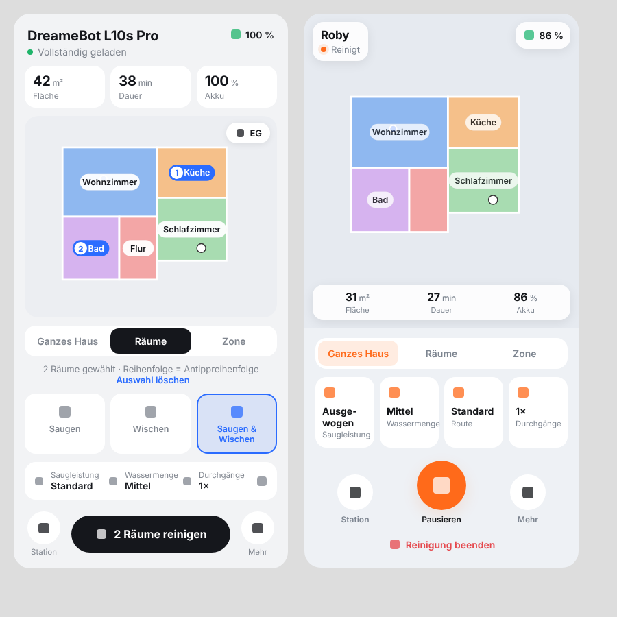
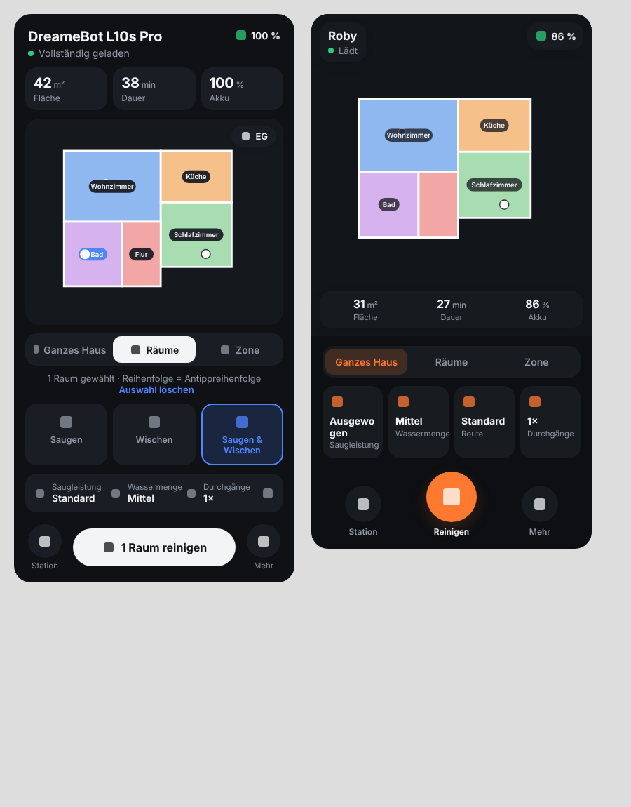

# Robot App Card

Lovelace-Karte für Saugroboter im Stil der Hersteller-Apps – für **Dreame** (Tasshack/dreame-vacuum) und **Roborock** (Core-Integration + Roborock Custom Map).

| Hell | Dunkel |
|---|---|
|  |  |

## Funktionen

- Live-Karte mit **Raumauswahl per Antippen** (Reihenfolge = Reinigungsreihenfolge, nummeriert)
- **Zonenreinigung**: Rechtecke auf der Karte aufziehen (bis 5 Zonen)
- **Ganzes Haus**, Pause/Fortsetzen, Stopp, zur Station, Roboter finden
- Saugleistung, Wassermenge, Reinigungsmodus, Route, Durchgänge (1–3×)
- **Wartung** mit Restlaufzeit, Fortschrittsbalken und Zurücksetzen
- **Station**-Aktionen (Absaugen, Mopp waschen/trocknen …), Kartenwechsel (EG/OG)
- Zwei Layouts: `dreame` und `roborock`, Hell/Dunkel folgt dem HA-Theme
- **Automatische Erkennung** aller Entitäten über das Gerät – keine Sensornamen nötig

## Installation über HACS

1. HACS → ⋮ → **Benutzerdefinierte Repositories** → `https://github.com/TheHangMan97/robot-app-card`, Typ **Dashboard**
2. „Robot App Card“ installieren
3. Browser neu laden (Strg+F5)

**Roborock:** zusätzlich die Integration [Roborock Custom Map](https://github.com/Lash-L/RoborockCustomMap) installieren – sie liefert das Kartenbild mit Räumen und Kalibrierung.

## Konfiguration

Die Karte hat einen **visuellen Editor** im normalen Home-Assistant-Einstellungsmenü: Dashboard bearbeiten → Karte hinzufügen → „Robot App Card“. Dort lassen sich Roboter, Layout, Dunkelmodus, Akzentfarbe, Raumnamen, ausgeblendete Räume und optionale Entitäten einstellen – die erkannten Räume werden direkt aufgelistet. Alternativ geht alles weiterhin per YAML:

```yaml
type: custom:robot-app-card
entity: vacuum.dreame_l10s_pro
style: dreame
```

```yaml
type: custom:robot-app-card
entity: vacuum.roborock_s8
style: roborock
room_names:
  16: Wohnzimmer
  17: Küche
```

| Option | Standard | Beschreibung |
|---|---|---|
| `entity` | – | Vacuum-Entität (Pflicht) |
| `style` | `auto` | `dreame`, `roborock` oder `auto` (nach Integration) |
| `name` | Gerätename | Titel |
| `map_entity` | automatisch | Camera-/Image-Entität der Karte |
| `room_names` | aus Kartendaten | Raum-ID → Name |
| `hide_rooms` | – | Liste von Raum-IDs, die ausgeblendet werden |
| `accent` | Layout-Farbe | Akzentfarbe, z. B. `"#2b6cff"` |
| `dark` | `auto` | `true` / `false` / `auto` |
| `battery_entity`, `status_entity` | automatisch | Überschreiben der Erkennung |

## Hinweise

- Raum- und Zonenreinigung brauchen eine Karte mit `calibration_points` und `rooms` (Dreame: Kamera der Integration, Roborock: `image.*_custom`).
- Kartenbearbeitung (Räume teilen, Sperrzonen) ist nicht enthalten.

## Lizenz

MIT
